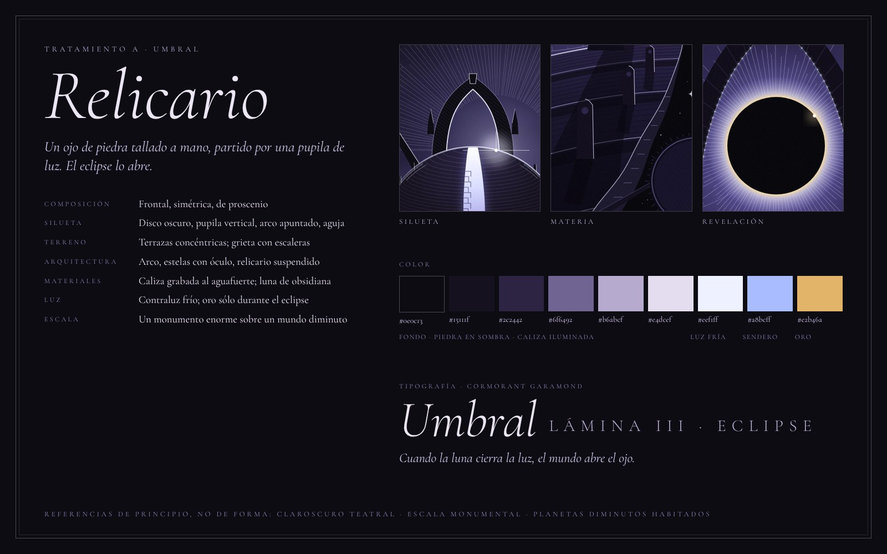
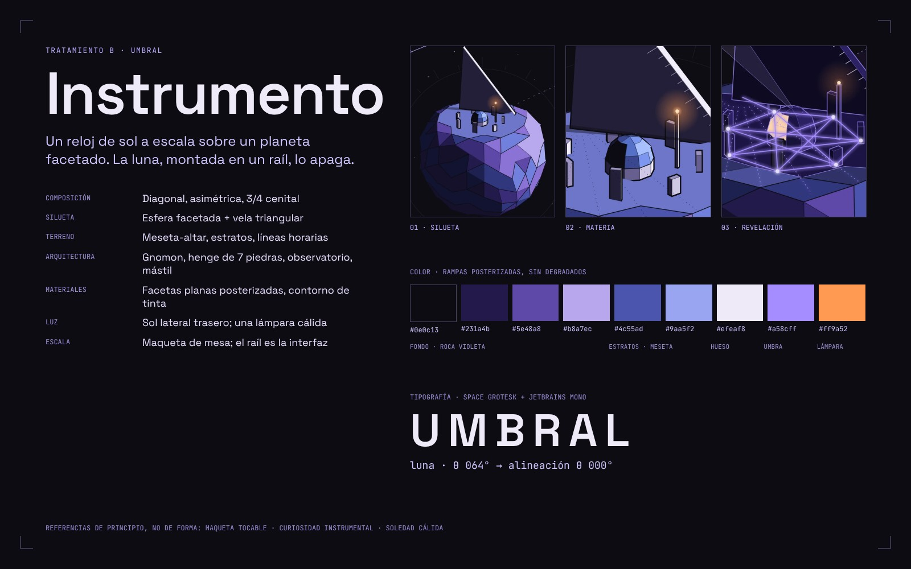
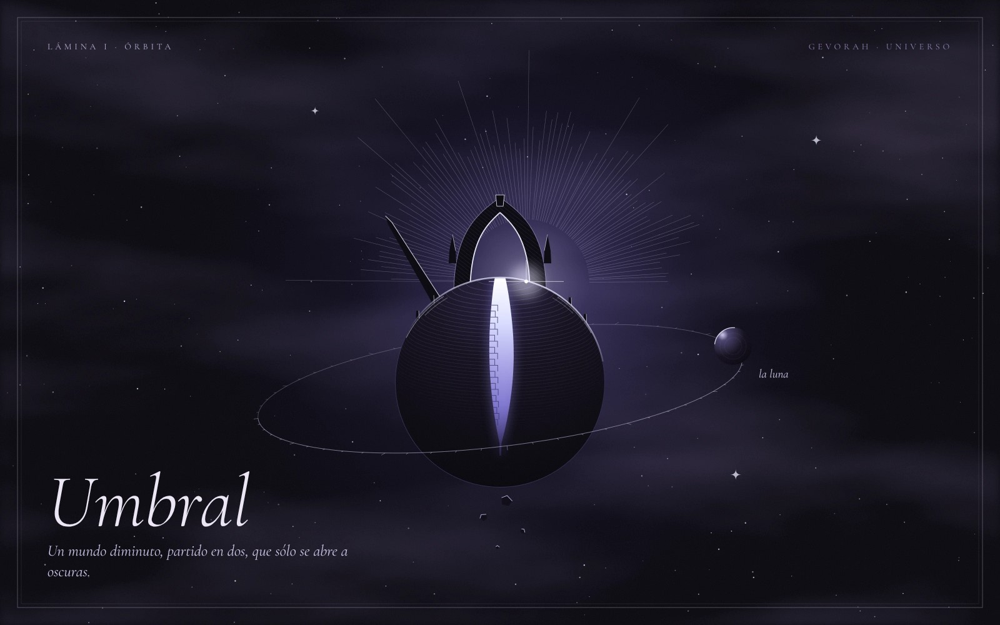
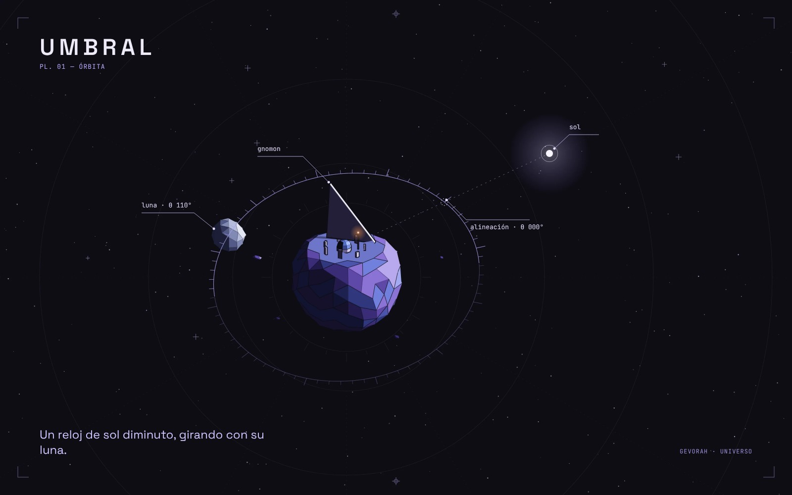
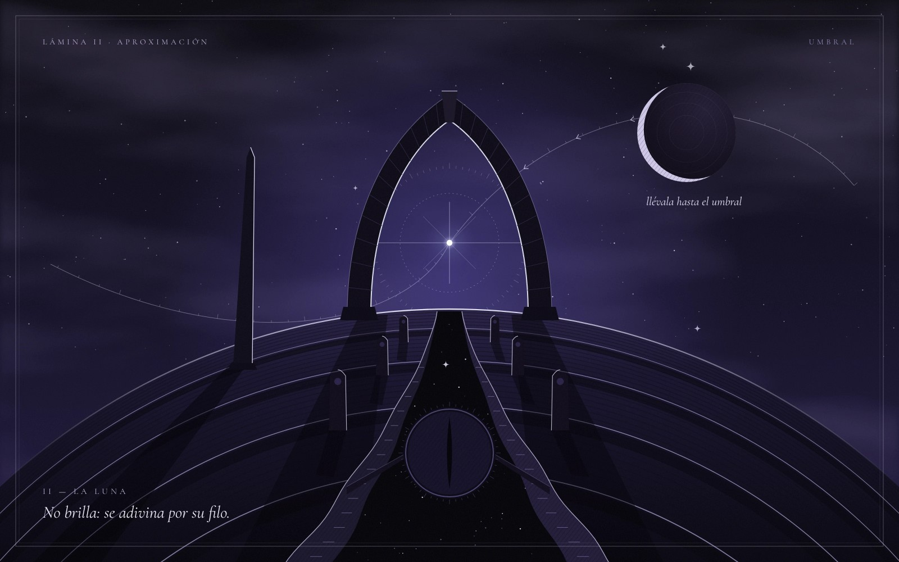
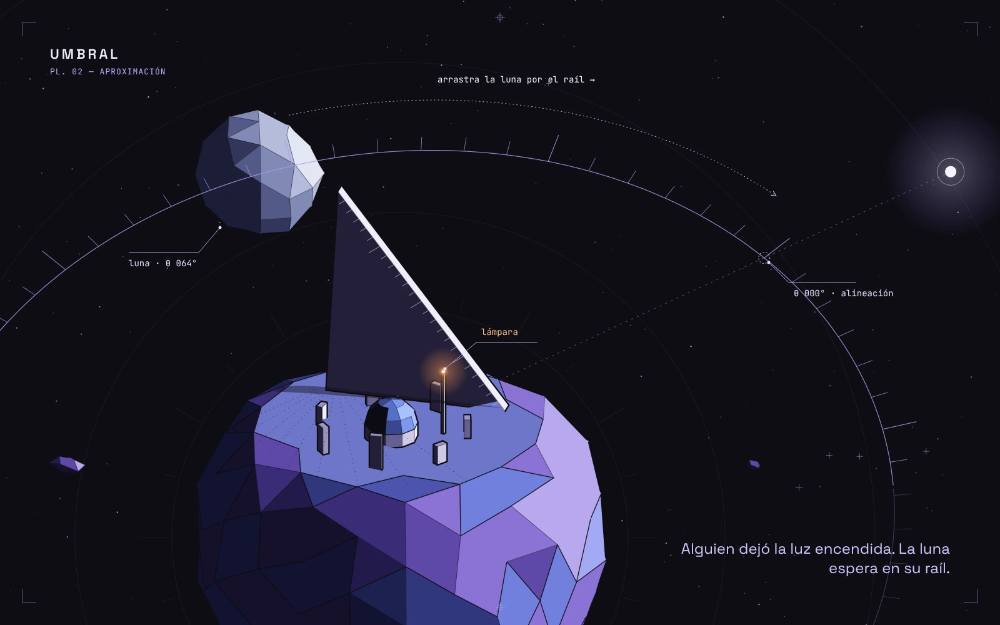
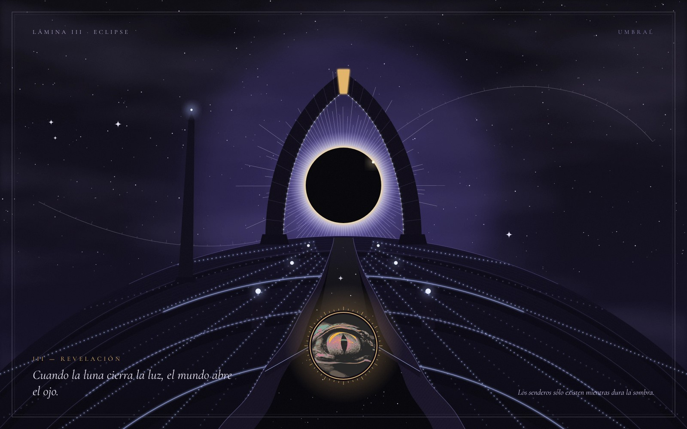
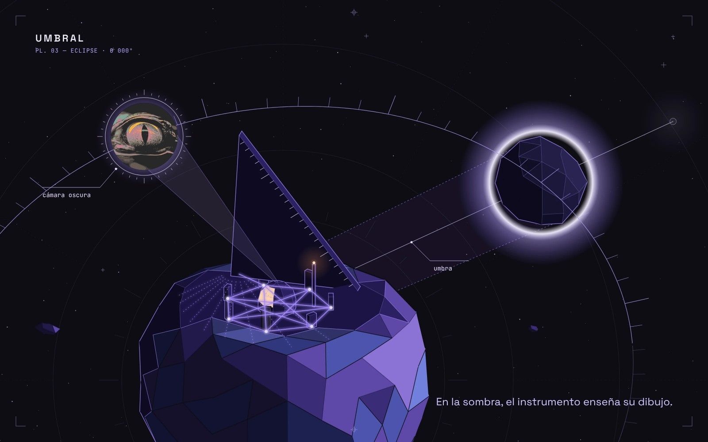

# Umbral — exploraciones visuales

Primer mundo del universo de gevorah. Umbral es un planeta diminuto con una
luna; el visitante mueve la luna por su órbita hasta provocar un eclipse, y
durante el fenómeno el mundo revela senderos, activa estructuras y permite un
pequeño descubrimiento: el avatar original, sin modificar.

Aquí hay **dos tratamientos artísticos** con los **tres estados** de la misma
experiencia cada uno. Son para revisar antes de pasar alguno a código: no son
una implementación.

| | A · Relicario | B · Instrumento |
|---|---|---|
| Hoja |  |  |
| 1 · Órbita |  |  |
| 2 · Aproximación y luna |  |  |
| 3 · Eclipse y revelación |  |  |

## A · Relicario

Umbral es una **reliquia tallada**: un ojo de piedra. Una grieta vertical
parte el planeta (la pupila) y sobre ella se levanta un arco apuntado (el
umbral). La luna es lisa y oscura, casi invisible.

1. **Órbita.** Contraluz: la estrella queda justo detrás del planeta. Sólo la
   grieta deja pasar la luz, así que desde lejos Umbral es un disco negro con
   una pupila encendida, coronado por el arco y la aguja.
2. **Aproximación.** Cámara baja, frontal y simétrica, como un proscenio. La
   grieta corre hacia el arco, que enmarca la estrella. La luna sólo se
   adivina por su filo creciente; una órbita grabada y un dial alrededor de la
   estrella indican adónde llevarla.
3. **Eclipse.** La luna tapa la estrella **dentro del arco**. La clave del arco
   se vuelve oro, las estelas encienden su óculo y el suelo dibuja un **iris**
   de senderos fríos alrededor de la grieta. En el fondo de la grieta se abre
   el relicario suspendido y aparece el avatar: un ojo dentro de un ojo.

## B · Instrumento

Umbral es un **instrumento a escala**: un reloj de sol. Un planeta facetado
con una meseta-altar, una vela triangular (el gnomon), un henge de siete
piedras, un observatorio y un mástil con la única luz cálida. La luna va
montada sobre el raíl de un orrery.

1. **Órbita.** Vista 3/4 desde arriba, como una maqueta sobre la mesa. La
   silueta se lee al instante (esfera + vela) y el raíl con sus marcas ya es la
   interfaz: un eje discontinuo une el sol con la meseta.
2. **Aproximación.** El planeta llena la parte baja del cuadro. La luna,
   cercana y facetada, está fuera del eje; un arco punteado indica que hay que
   arrastrarla por el raíl hasta la marca de alineación.
3. **Eclipse.** Se ve **desde fuera**: el cono de umbra cae sobre la meseta.
   Lo que queda en sombra pasa a una rampa nocturna, sus aristas se encienden y
   aparece un heptagrama entre las piedras del henge. La rendija del
   observatorio se vuelve cálida y proyecta el avatar como una cámara oscura.

## En qué se diferencian

| | A · Relicario | B · Instrumento |
|---|---|---|
| Composición | Frontal, simétrica, teatral | Diagonal, asimétrica, 3/4 cenital |
| Silueta | Disco oscuro + pupila + arco apuntado + aguja | Esfera facetada + vela triangular |
| Terreno | Terrazas concéntricas, grieta con escaleras | Meseta plana, estratos inclinados, líneas horarias |
| Arquitectura | Arco, estelas con óculo, relicario | Gnomon, henge, observatorio, mástil |
| Materiales | Caliza grabada (aguafuerte), obsidiana, grano de lámina | Facetas planas posterizadas, contorno de tinta |
| Luz | Contraluz y claroscuro; brillo frío que revela | Sol lateral trasero, tonos en escalones duros |
| Acento cálido | Sólo en el eclipse: corona, clave, relicario | Siempre, pero mínimo: lámpara y puerta |
| Escala | Monumento enorme sobre un mundo diminuto | Maqueta de mesa, objeto que se puede tocar |
| Eclipse | Visto desde el suelo, enmarcado por el arco | Visto desde fuera, como sombra proyectada |
| Revelación | Iris de senderos; el avatar en un relicario | Heptagrama encendido; el avatar proyectado |
| Tipografía | Cormorant Garamond: cursiva, versalitas espaciadas | Space Grotesk + JetBrains Mono: notas de campo |
| Lenguaje | Pintura/grabado 2D | Modelo low-poly hecho a mano |

A es más íntimo y melancólico; B es más curioso, más táctil y más cercano al
lenguaje gráfico que gevorah ya usa (ilustración plana con contornos).

En los dos el fondo es `#0e0c13`, la gama se mueve entre violetas y azules, y
el avatar se usa tal cual (sin recolorear ni redibujar).

## Archivos

- `frames/*.svg`: ilustraciones de cada estado, sin tipografía ni avatar.
  `frames/*.json` guarda las anclas (posición de la luna, el relicario, etc.)
  para colocar texto y avatar encima.
- `renders/*.jpg`: composiciones finales (ilustración + tipografía + avatar).
- `src/relicario.py`: tratamiento A. Formas dibujadas a mano en coordenadas
  de lámina; el script sólo genera las tramas repetitivas (líneas de grabado,
  estrellas, marcas).
- `src/instrumento.py`: tratamiento B. Un modelo 3D mínimo hecho a mano
  (meseta, gnomon, henge, observatorio, luna, raíl) proyectado con una cámara
  ortográfica, para que los tres estados muestren exactamente el mismo objeto.
  Sólo traza contornos donde cambia el tono, así que se ven manchas planas y
  no una malla.
- `src/render.mjs`: pasa un SVG a PNG con el Chromium de Playwright.

Para regenerar:

```bash
cd explorations/umbral/src
python3 relicario.py      # frames/a1..a3
python3 instrumento.py    # frames/b1..b3
node render.mjs ../frames/a3.svg a3.png 1600 1000 2
```
