# Umbral — tres identidades

Tercera ronda. Replantea la geografía de Umbral desde cero manteniendo la
premisa: un planeta oceánico pequeño donde la sombra de su luna levanta una
región del mar, el agua flota como un segundo cielo y deja al aire un paisaje
sumergido. No conserva nada de la ronda anterior (Gancho, Cresta, Salar,
Dientes, Fosa, cráter).

La presentación completa, con la comparación y la crítica, está en
`page/index.html`.

| | I · Las Dolinas | II · La Cintura | III · Los Dos Mares |
|---|---|---|---|
| A · Órbita | 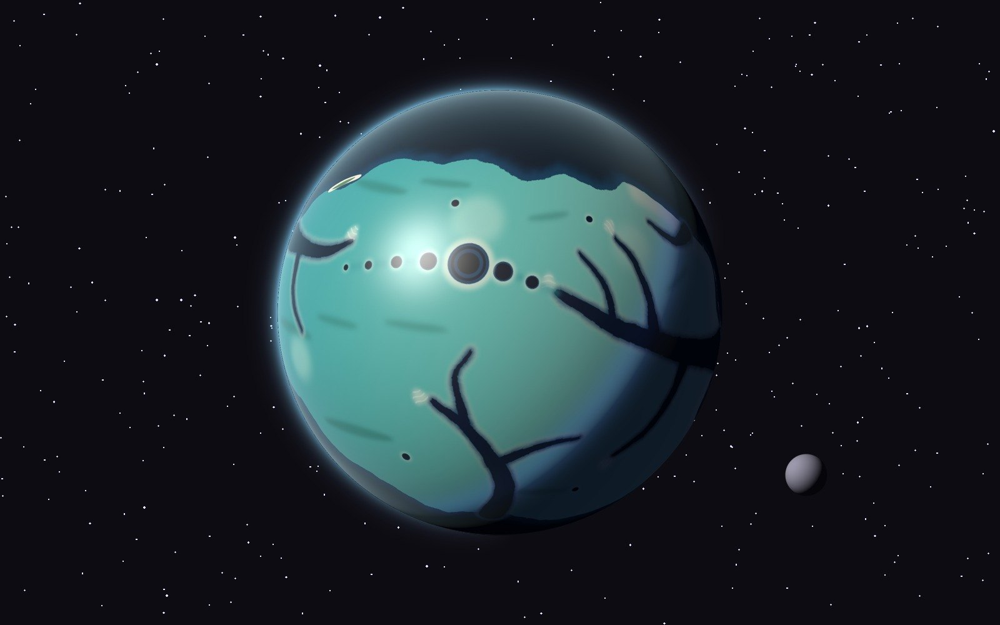 | 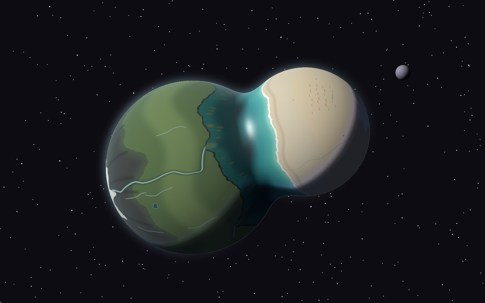 | 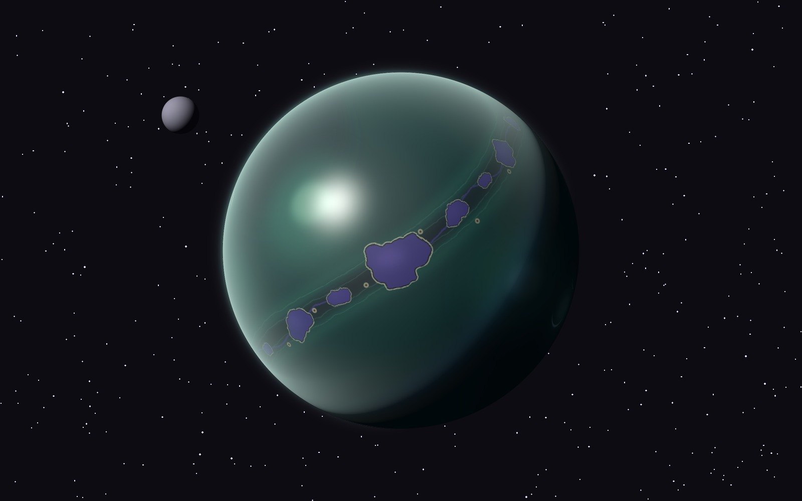 |
| B · Distribución | 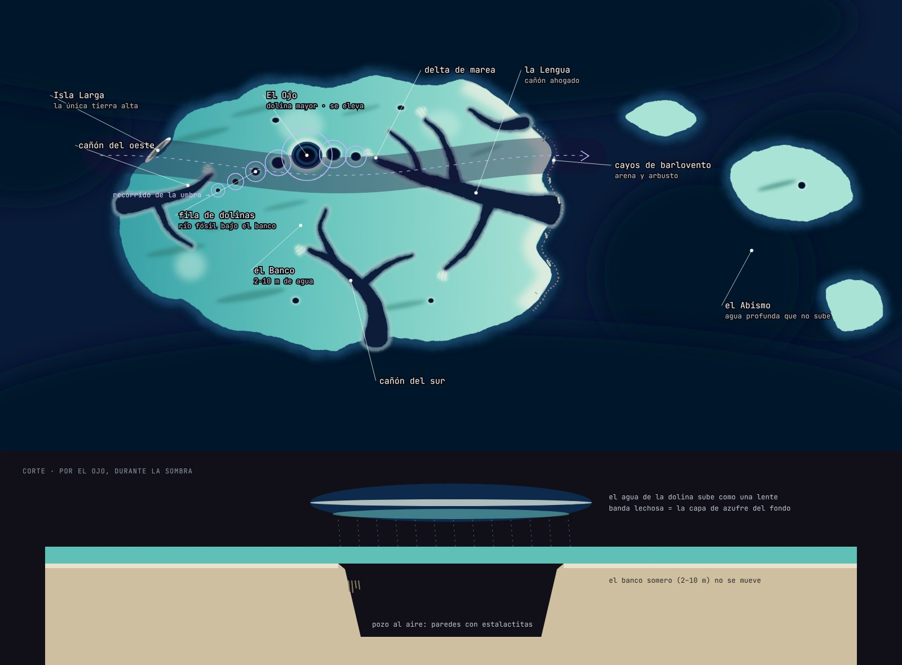 | 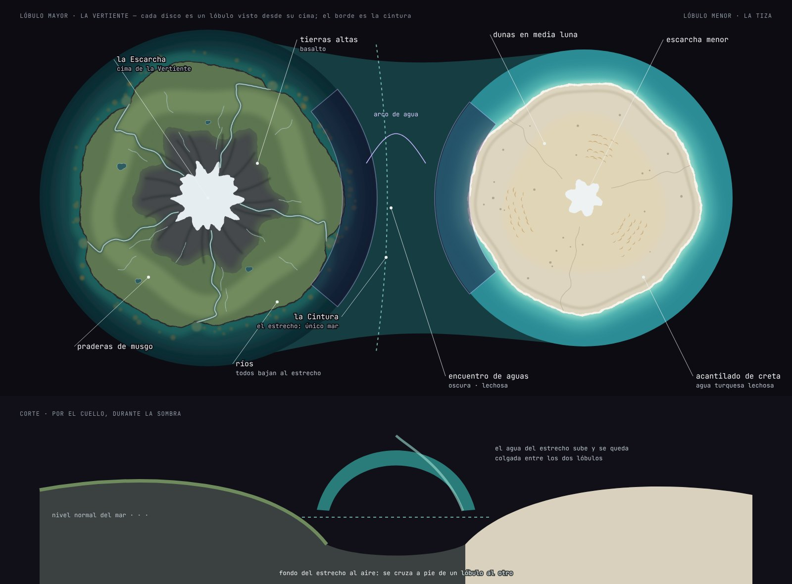 | 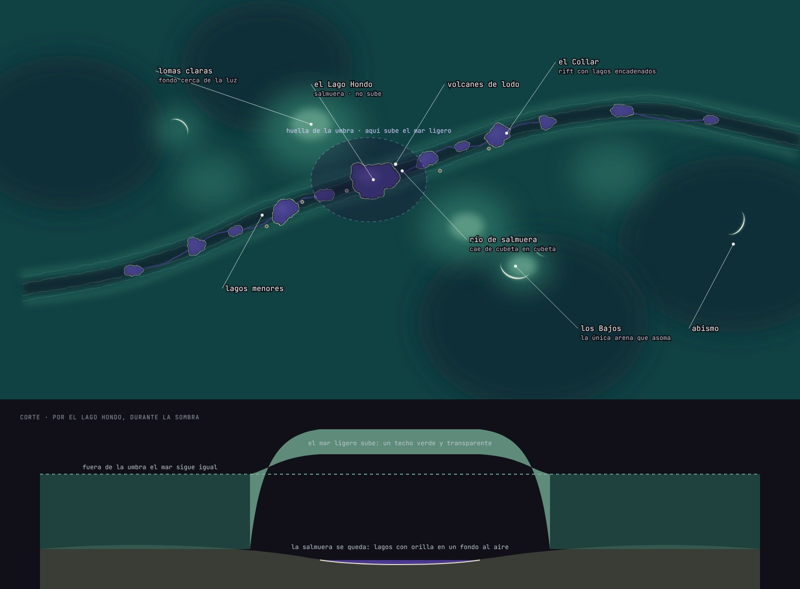 |
| C · Estudio | 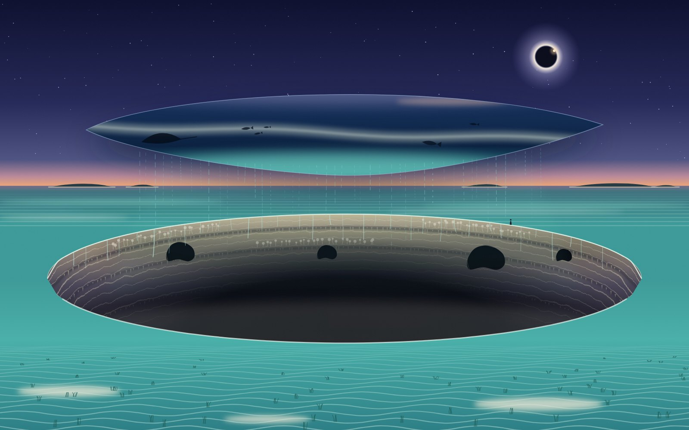 | 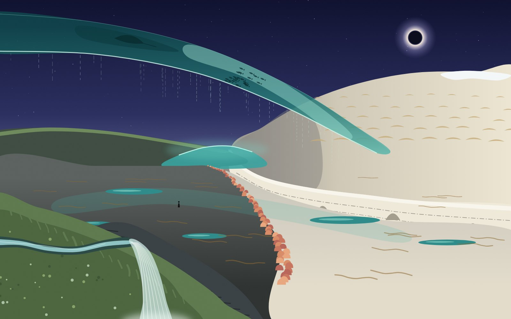 | 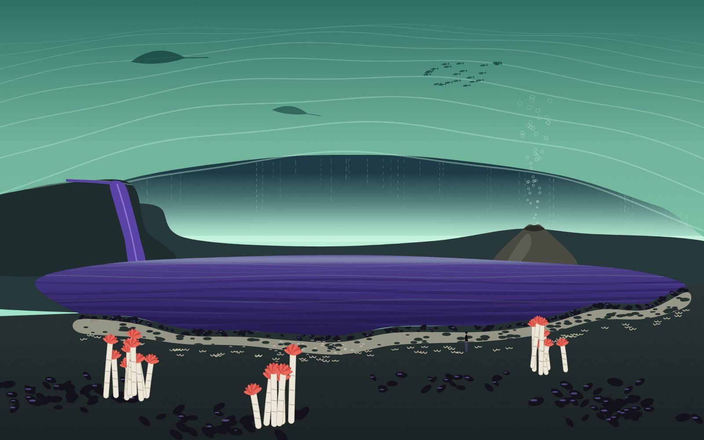 |

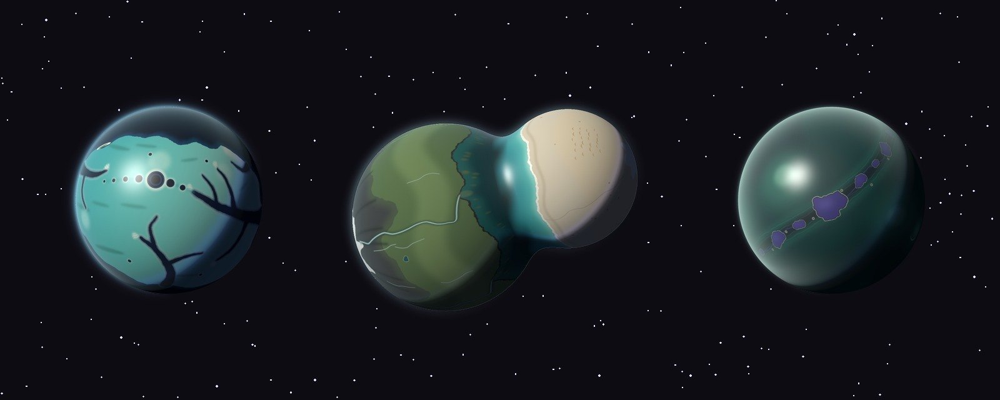
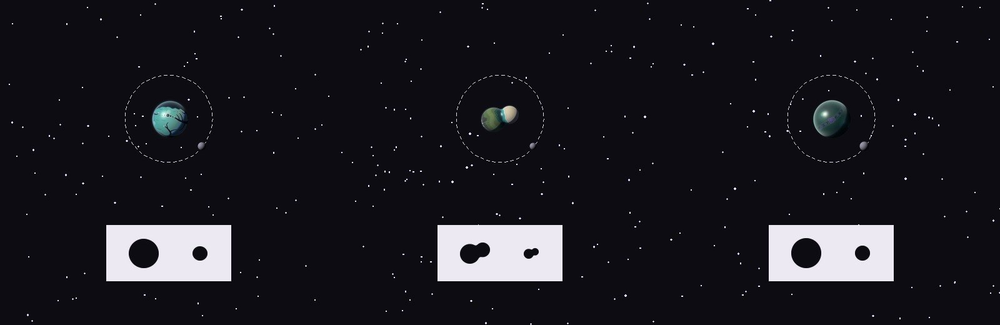

- **I · Las Dolinas.** Un banco somero y claro con cañones ahogados. Sólo sube
  el agua de los pozos (la que nunca ve la luz), que flota como lentes sobre
  ellos.
- **II · La Cintura.** Un binario de contacto con el mar en el cuello. En la
  sombra el estrecho queda colgado en arco entre los dos lóbulos y se puede
  cruzar a pie.
- **III · Los Dos Mares.** Un océano transparente con lagos de salmuera violeta
  en el fondo. Sube el mar ligero; la salmuera se queda.

Recomendación (no aprobada): La Cintura.

## Cómo se hizo

Los mapas están pintados a mano en SVG (`src/map_*.py`: las formas se colocan
una a una en coordenadas de longitud y latitud o en discos polares). `globe.py`
los proyecta sobre una esfera o sobre el cuerpo de dos lóbulos con una luz
simple, sólo para comprobar cómo se leen desde la órbita: no genera geografía.
Los estudios cercanos (`src/study_*.py`) son ilustraciones vectoriales.

```bash
cd explorations/umbral/identidades/src
python3 map_dolinas.py && python3 map_cintura.py && python3 map_dosmares.py
python3 orbits.py && python3 diagrams.py
python3 study_dolinas.py && python3 study_cintura.py && python3 study_dosmares.py
python3 compose.py
```

`work/` y `renders/` son material intermedio y no se versionan; las imágenes publicadas están en `page/img/`.
