# Umbral — dos mundos

Segunda ronda de exploración del primer planeta de Small Worlds. Sustituye a
los tratamientos *Relicario* e *Instrumento* de la carpeta superior: no se
reutiliza ninguna de sus geometrías ni composiciones.

Dos propuestas, cuatro escenas cada una (órbita, aproximación,
transformación, descubrimiento), un mapa con los accidentes geográficos, una
comparación de siluetas a la misma escala y una crítica. La presentación
completa está en `index.html` (ábrela directamente en el navegador).

| | A · El Mar Suspendido | B · El Archipiélago del Reverso |
|---|---|---|
| Mapa | 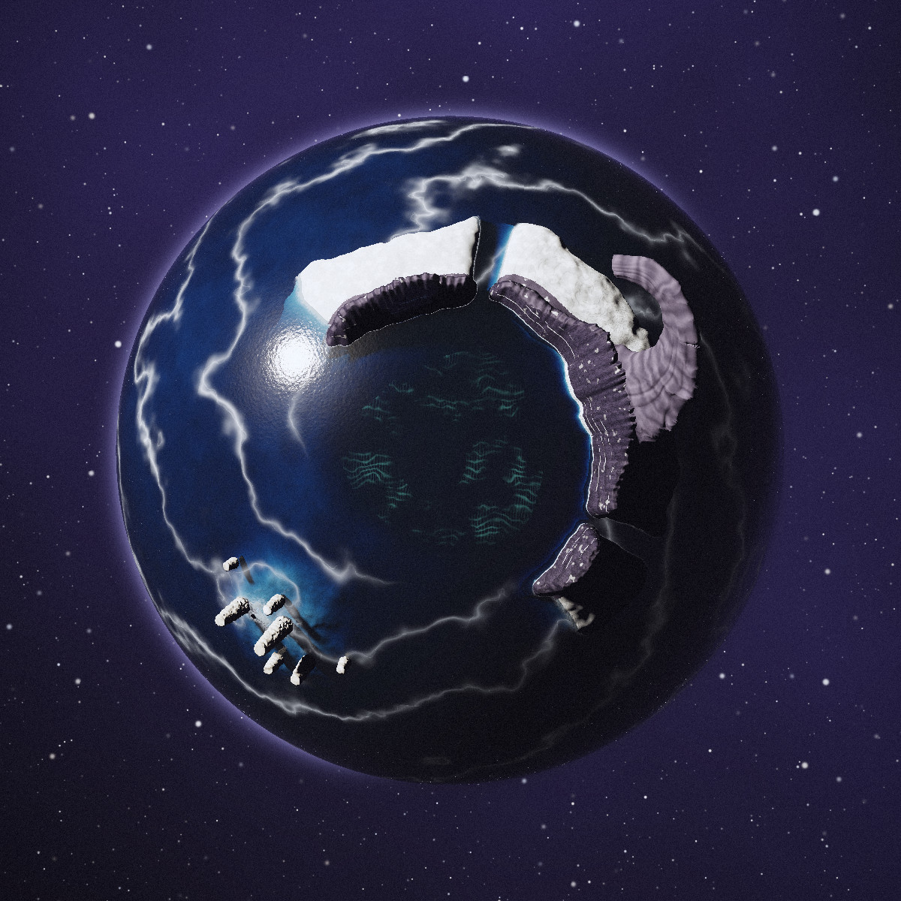 | 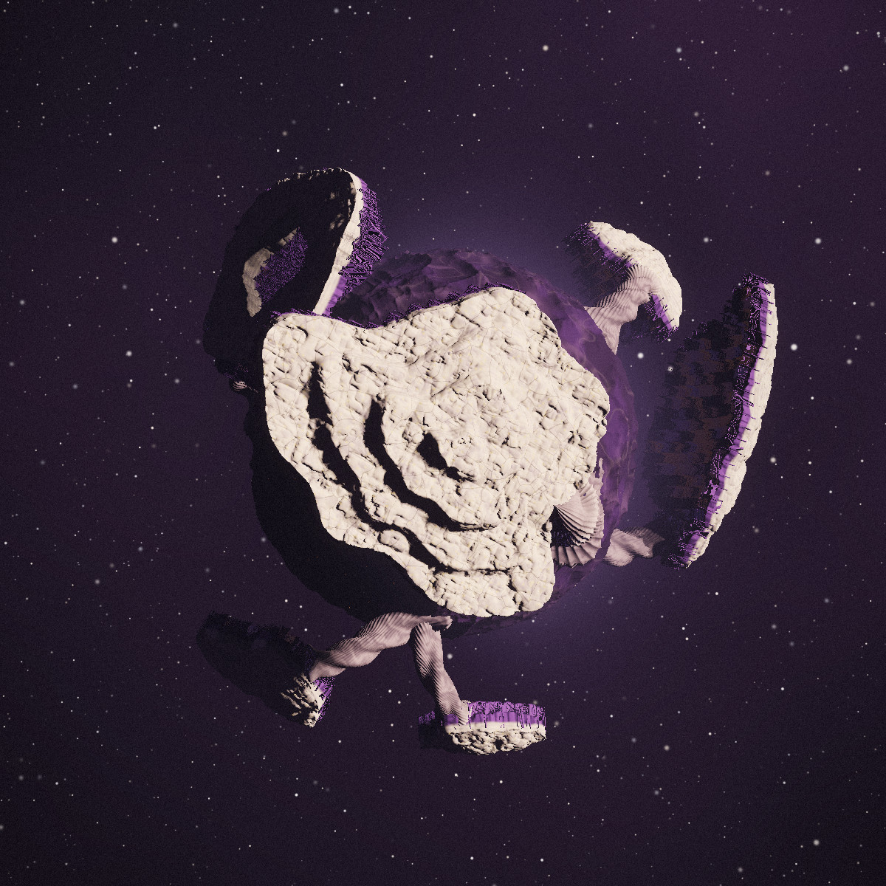 |
| 01 · Órbita | 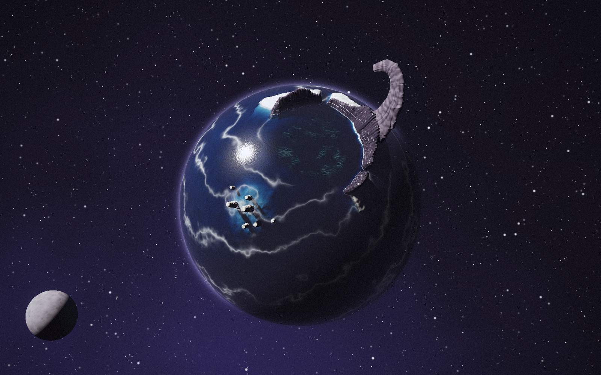 | 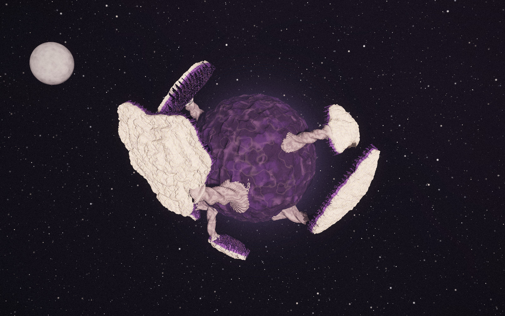 |
| 02 · Aproximación | 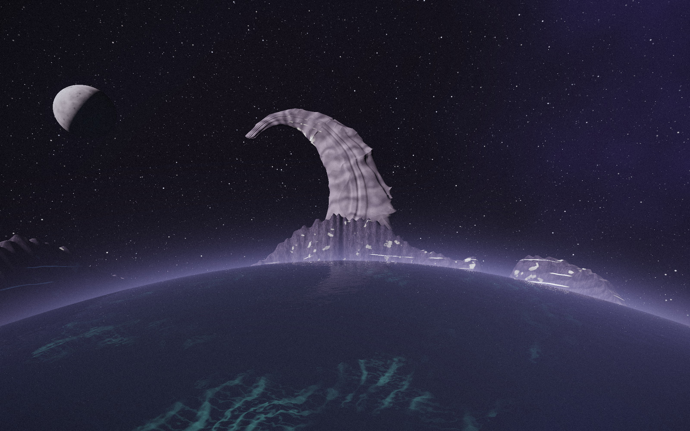 | 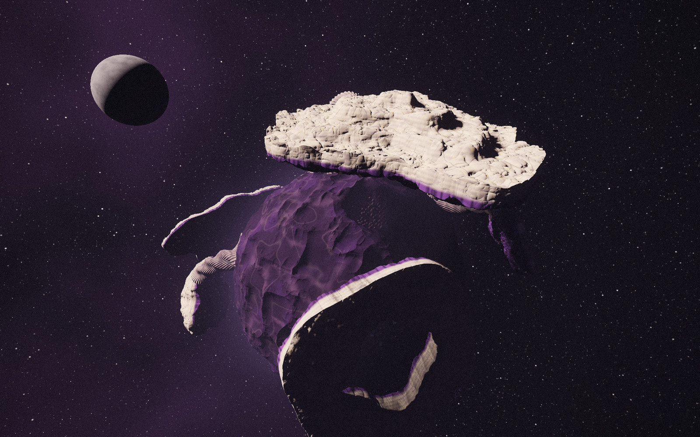 |
| 03 · Transformación | 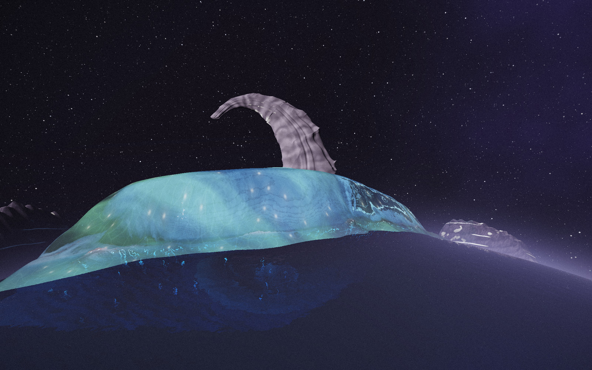 | 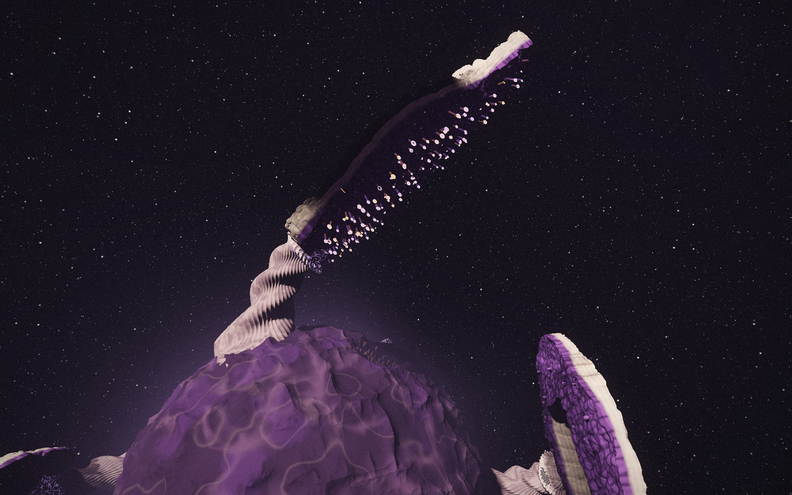 |
| 04 · Descubrimiento | 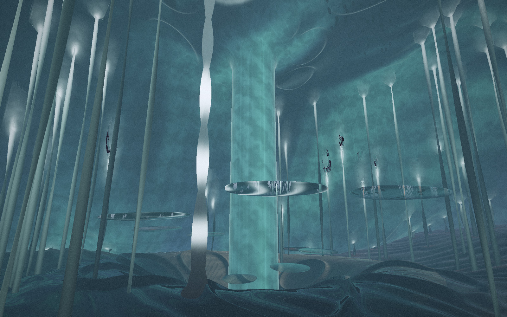 | 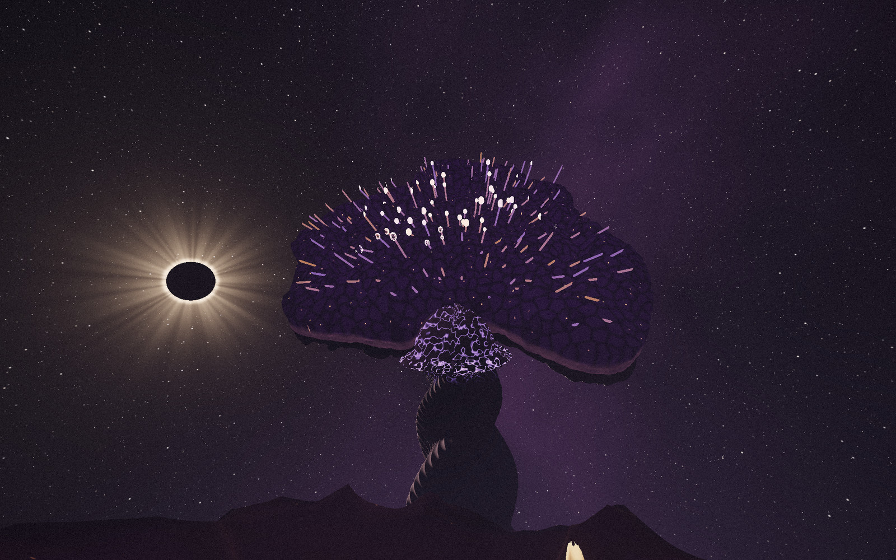 |

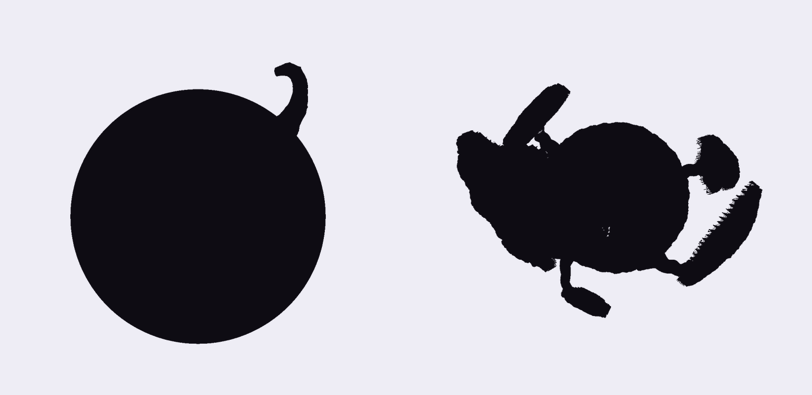

## A · El Mar Suspendido

Un océano de tinta con un cráter sumergido del que sólo queda medio borde (la
Cresta) y, en su punto más alto, una laja volcada sobre el agua (el Gancho).
Con la sombra de la luna, el agua profunda de la Fosa sube como una lámina
luminosa sujeta por organismos anclados al fondo (las amarras) y deja al aire
el Jardín de Amarras. La Sima, en el centro, sigue llena: una columna une el
suelo con el techo de agua. Interacción: tañer las amarras.

## B · El Archipiélago del Reverso

Un núcleo húmedo (el Sotobosque) con seis islas sujetas por un borde a tallos
trenzados. Entre tallo e isla hay un pulvínulo, la articulación con la que la
mimosa pliega sus hojas de noche. Con la sombra, las islas tocadas por la
umbra se abren como tapas: muestran su reverso de musgo y farolillos y
destapan la Umbría, la hondonada bajo la Meseta. Interacción: abrir las vainas
de la Umbría.

## Recomendación

Prototipar A, llevándose de B la idea de la articulación viva. La crítica
completa, criterio por criterio, está en `index.html`.

## Cómo se generan

Cada propuesta es un único modelo procedural de campos de distancia (SDF) con
su luz y su luna, trazado con un raymarcher propio en C++. Las cuatro escenas
son cámaras distintas sobre el mismo modelo, de modo que la ubicación, las
proporciones y la relación con la luz de cada accidente son idénticas.

- `src/common.h`: vectores, ruido, cámara y salida HDR.
- `src/mar.cpp`: propuesta A.
- `src/rev.cpp`: propuesta B.
- `src/post.py`: revelado (tonemap, viraje, grano).
- `src/finish.py`: láminas finales, siluetas y anclas de los mapas.

```bash
cd explorations/umbral/mundos
./render_all.sh 2000 1250   # ~15 min con 4 núcleos; escribe out/*.swhdr
python3 src/finish.py       # escribe renders/*.jpg, siluetas.png y anchors.json
```

`out/` es material intermedio y no se versiona.
